# TP10 – Authentification personnalisée et gestion des rôles avec Spring Security

Dans ce TP, j'ai approfondi la configuration de **Spring Security** dans une application web **Spring Boot 4** (Spring MVC + Thymeleaf).
Par rapport au TP9, le formulaire de connexion est davantage personnalisé : URL de traitement du login renommée (`/authenticate`), page d'accueil imposée après connexion (`/home`), URL d'échec et URL de déconnexion explicites.
L'application contient deux espaces protégés : un **espace utilisateur** (rôles `USER` et `ADMIN`) et un **espace administrateur** (rôle `ADMIN` uniquement).

---

## Sommaire

1. [Objectifs](#1-objectifs)
2. [Technologies utilisées](#2-technologies-utilisées)
3. [Structure du projet](#3-structure-du-projet)
4. [Explication du code](#4-explication-du-code)
5. [Routes et règles d'accès](#5-routes-et-règles-daccès)
6. [Lancer le projet](#6-lancer-le-projet)
7. [Tests et captures d'écran](#7-tests-et-captures-décran)
8. [Remarques et limites](#8-remarques-et-limites)
9. [Conclusion](#9-conclusion)

---

## 1. Objectifs

- Configurer Spring Security avec un bean `SecurityFilterChain`.
- Personnaliser entièrement le formulaire de connexion : page (`loginPage`), URL de traitement (`loginProcessingUrl`), redirection après succès (`defaultSuccessUrl`) et après échec (`failureUrl`).
- Configurer la déconnexion (`logoutUrl`, `logoutSuccessUrl`).
- Protéger des URL par rôle avec `hasRole` et `hasAnyRole`.
- Déclarer des utilisateurs en mémoire avec `InMemoryUserDetailsManager`.
- Vérifier le comportement de chaque rôle dans le navigateur.

## 2. Technologies utilisées

| Outil | Version | Rôle |
|-------|---------|------|
| Java | 17+ (exécuté avec Java 21) | Langage |
| Spring Boot | 4.1.2 | Framework principal |
| Spring MVC (`spring-boot-starter-webmvc`) | 7.x | Couche web (contrôleur) |
| Spring Security (`spring-boot-starter-security`) | 7.x | Authentification et autorisation |
| Thymeleaf (`spring-boot-starter-thymeleaf`) | 3.1 | Moteur de templates HTML |
| `thymeleaf-extras-springsecurity6` | – | Intégration Thymeleaf / Spring Security |
| Spring Boot DevTools | – | Redémarrage automatique pendant le développement |
| JUnit 5 | – | Test de chargement du contexte |
| Maven Wrapper | – | Build |

## 3. Structure du projet

```
tp10
├── pom.xml
├── screenshots/                               ← captures utilisées dans ce README
└── src
    ├── main
    │   ├── java/ma/fstg/security
    │   │   ├── Tp10Application.java           ← point d'entrée (package racine)
    │   │   ├── config/SecurityConfig.java     ← utilisateurs + règles de sécurité
    │   │   └── web/AuthController.java        ← routes /login, /home, /user/**, /admin/**
    │   └── resources
    │       ├── application.properties
    │       └── templates
    │           ├── login.html                 ← formulaire de connexion (avec CSS)
    │           ├── home.html                  ← page d'accueil après connexion
    │           ├── user-dashboard.html        ← espace USER / ADMIN
    │           └── admin-dashboard.html       ← espace ADMIN
    └── test/java/ma/fstg/security/tp10
        └── Tp10ApplicationTests.java          ← test de chargement du contexte
```

Ici, `Tp10Application` est placée dans le **package racine** `ma.fstg.security`.
Les packages `config` et `web` sont donc des sous-packages : Spring les trouve automatiquement, sans `scanBasePackages` (contrairement au TP9).

Parcours d'une requête :

```
Navigateur
    │  HTTP
    ▼
SecurityFilterChain ── non connecté ──────────► redirection vers /login
    │               ── connecté, mauvais rôle ─► 403 Forbidden
    │ autorisé
    ▼
AuthController ──► template Thymeleaf
```

## 4. Explication du code

### 4.1 Les utilisateurs en mémoire

```java
@Bean
public UserDetailsService userDetailsService() {
    UserDetails admin = User.withUsername("admin")
            .password("{noop}1234")
            .roles("ADMIN")
            .build();

    UserDetails user = User.withUsername("user")
            .password("{noop}1111")
            .roles("USER")
            .build();

    return new InMemoryUserDetailsManager(admin, user);
}
```

| Utilisateur | Mot de passe | Rôle | Accès |
|-------------|--------------|------|-------|
| `user` | `1111` | `USER` | `/home`, `/user/**` |
| `admin` | `1234` | `ADMIN` | `/home`, `/user/**`, `/admin/**` |

- Le préfixe `{noop}` indique au `DelegatingPasswordEncoder` (utilisé par défaut par Spring Security) que le mot de passe est stocké **en clair**, sans chiffrement.
- Comme ce bean `UserDetailsService` existe, Spring Boot ne crée plus l'utilisateur par défaut et n'affiche plus de mot de passe généré dans la console.
- Contrairement au TP9, `admin` n'a **que** le rôle `ADMIN`. Il peut quand même ouvrir l'espace utilisateur grâce à `hasAnyRole("USER", "ADMIN")` (voir 4.2).

### 4.2 Les règles d'autorisation

```java
.authorizeHttpRequests(auth -> auth
        .requestMatchers("/login", "/css/**").permitAll()
        .requestMatchers("/admin/**").hasRole("ADMIN")
        .requestMatchers("/user/**").hasAnyRole("USER", "ADMIN")
        .anyRequest().authenticated()
)
```

- Les règles sont évaluées **dans l'ordre** : la première qui correspond à l'URL s'applique.
- Seuls `/login` et les fichiers CSS sont publics. Toutes les autres pages, y compris `/home`, demandent d'être connecté.
- `hasRole("ADMIN")` vérifie l'autorité `ROLE_ADMIN` : Spring ajoute le préfixe `ROLE_` tout seul.
- `hasAnyRole("USER", "ADMIN")` accepte l'un **ou** l'autre des rôles.

### 4.3 Le formulaire de connexion personnalisé

```java
.formLogin(form -> form
        .loginPage("/login")
        .loginProcessingUrl("/authenticate")
        .defaultSuccessUrl("/home", true)
        .failureUrl("/login?error=true")
        .permitAll()
)
```

| Méthode | Rôle |
|---------|------|
| `loginPage("/login")` | Page affichée quand l'utilisateur doit se connecter (servie par `AuthController`). |
| `loginProcessingUrl("/authenticate")` | URL qui reçoit le **POST** du formulaire. Spring Security la traite lui-même : aucun contrôleur n'est nécessaire. |
| `defaultSuccessUrl("/home", true)` | Après un login réussi, redirige **toujours** vers `/home`. Le `true` ignore la page demandée au départ. |
| `failureUrl("/login?error=true")` | Après un échec, retour au login avec le paramètre `error`. |

Le formulaire `login.html` envoie donc ses données vers `/authenticate` :

```html
<form th:action="@{/authenticate}" method="post">
    <input type="text" name="username" placeholder="Saisir le nom d’utilisateur" required>
    <input type="password" name="password" placeholder="Mot de passe" required>
    <button type="submit">Se connecter</button>
</form>

<p th:if="${param.error}" class="error">Identifiants incorrects, veuillez réessayer.
<p th:if="${param.logout}" class="logout">Vous êtes déconnecté avec succès.
```

- Les champs s'appellent `username` et `password`, les noms attendus par défaut par Spring Security.
- `th:action="@{...}"` ajoute **automatiquement** un champ caché contenant le jeton **CSRF**. Sans lui, le POST serait refusé.
- `${param.error}` et `${param.logout}` lisent les paramètres d'URL ajoutés après un échec de connexion ou une déconnexion.
- La page contient un petit bloc `<style>` pour centrer le formulaire dans une carte blanche.

### 4.4 La déconnexion

```java
.logout(logout -> logout
        .logoutUrl("/logout")
        .logoutSuccessUrl("/login?logout=true")
        .permitAll()
)
```

Les pages `home`, `user-dashboard` et `admin-dashboard` contiennent un bouton qui envoie un **POST** sur `/logout` :

```html
<form th:action="@{/logout}" method="post">
    <button type="submit" class="btn-logout">Se déconnecter</button>
</form>
```

Spring invalide la session, supprime l'authentification puis redirige vers `/login?logout=true`.

### 4.5 Le contrôleur

```java
@Controller
public class AuthController {

    @GetMapping("/login")
    public String login() { return "login"; }

    @GetMapping("/home")
    public String home() { return "home"; }

    @GetMapping("/admin/dashboard")
    public String adminDashboard() { return "admin-dashboard"; }

    @GetMapping("/user/dashboard")
    public String userDashboard() { return "user-dashboard"; }
}
```

Chaque méthode renvoie le nom d'un template Thymeleaf. Le contrôleur ne contient aucune vérification de rôle : tout est centralisé dans `SecurityConfig`.

## 5. Routes et règles d'accès

URL de base : `http://localhost:8080`

| Route | Anonyme | `user` (USER) | `admin` (ADMIN) |
|-------|---------|---------------|-----------------|
| `GET /login` | ✅ | ✅ | ✅ |
| `POST /authenticate` | traitement du login par Spring Security | | |
| `GET /home` | ↪ `/login` | ✅ | ✅ |
| `GET /user/dashboard` | ↪ `/login` | ✅ | ✅ |
| `GET /admin/dashboard` | ↪ `/login` | ⛔ 403 | ✅ |
| `POST /logout` | – | ↪ `/login?logout=true` | ↪ `/login?logout=true` |

## 6. Lancer le projet

**Prérequis :** JDK 17 ou plus récent. Maven n'est pas nécessaire, car le wrapper `mvnw` est fourni.

```bash
# Lancer l'application
./mvnw spring-boot:run          # Linux / macOS / Git Bash
mvnw.cmd spring-boot:run        # Windows (cmd)

# ou construire le jar puis l'exécuter
./mvnw clean package
java -jar target/tp10-0.0.1-SNAPSHOT.jar
```

Ouvrir ensuite http://localhost:8080/login et se connecter avec `user` / `1111` ou `admin` / `1234`.

Si le port 8080 est déjà utilisé (par exemple par le TP9 lancé depuis IntelliJ), on peut choisir un autre port sans modifier le code :

```bash
./mvnw spring-boot:run -Dspring-boot.run.arguments=--server.port=8081
```

C'est ce que j'ai fait pour les captures ci-dessous, d'où le port **8081** dans la barre d'adresse.

Pour lancer le test :

```bash
./mvnw test
```

## 7. Tests et captures d'écran

### 7.1 Démarrage de l'application

Tomcat démarre et DevTools est actif. La ligne `Global AuthenticationManager configured with UserDetailsService bean with name userDetailsService` confirme que Spring utilise les utilisateurs déclarés dans `SecurityConfig` : aucun mot de passe généré n'est affiché.

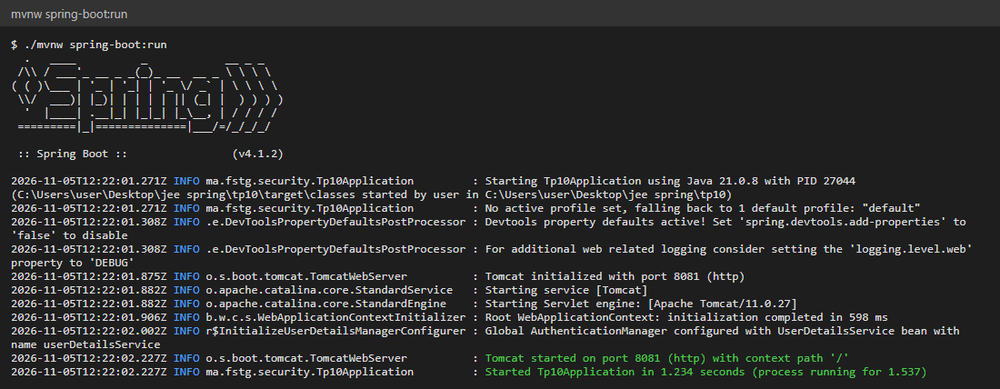

### 7.2 Accès à une page protégée sans être connecté

En ouvrant `/home` sans être connecté, Spring Security redirige vers la page de login personnalisée.

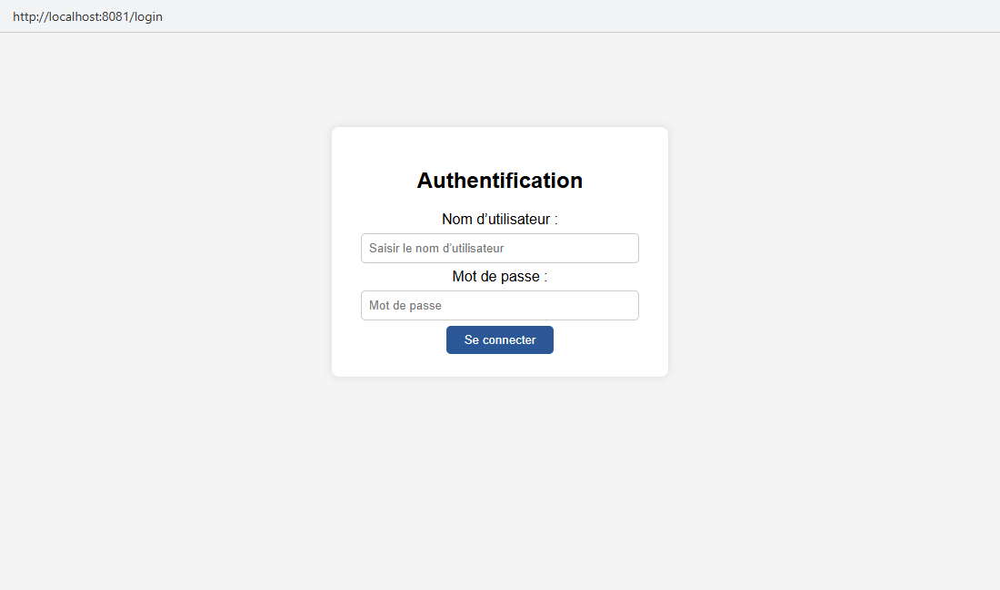

### 7.3 Mauvais mot de passe

Le formulaire est envoyé sur `/authenticate`. Avec un mot de passe incorrect, Spring redirige vers `/login?error=true` (la `failureUrl`) et le message rouge s'affiche.

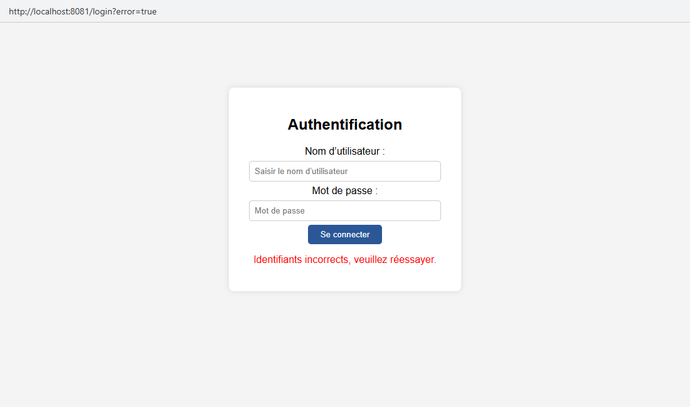

### 7.4 Connexion en tant que `user`

Après une connexion réussie avec `user` / `1111`, l'utilisateur arrive toujours sur `/home`, grâce à `defaultSuccessUrl("/home", true)`.


### 7.5 Espace utilisateur

`user` possède le rôle `USER`, il peut donc ouvrir `/user/dashboard`.

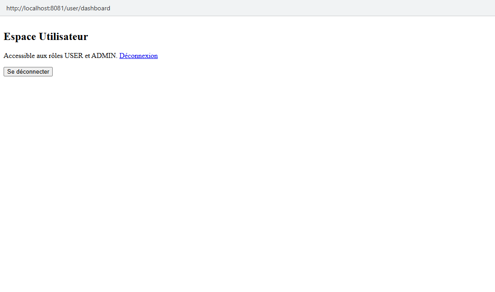

### 7.6 `user` essaie d'ouvrir l'espace administrateur → 403

`user` est connecté mais n'a pas le rôle `ADMIN`. Il n'est pas redirigé vers le login : il reçoit une erreur **403 Forbidden**.

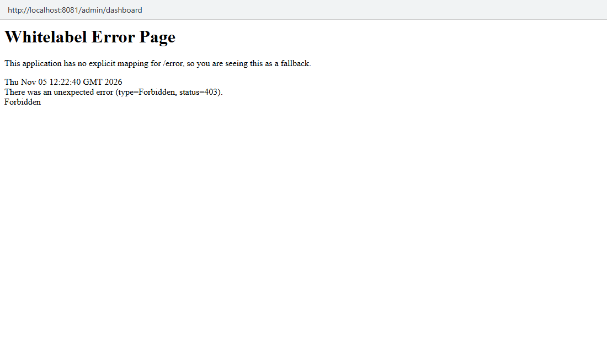

### 7.7 Le lien « Déconnexion » (GET) ne fonctionne pas

Les dashboards contiennent aussi un lien `<a th:href="@{/logout}">Déconnexion</a>`. Un lien envoie une requête **GET**, alors que le filtre de déconnexion de Spring Security n'accepte que le **POST** (protection CSRF).
La requête arrive donc jusqu'à Spring MVC, qui ne trouve aucune route `GET /logout` : erreur **404** (voir [remarque 8.1](#81-le-lien-déconnexion-renvoie-une-erreur-404)).

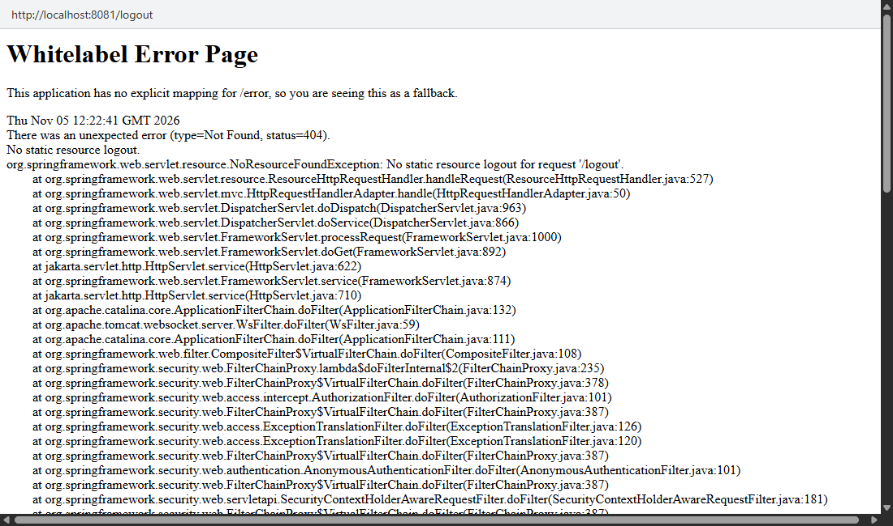

### 7.8 Déconnexion avec le bouton (POST)

Le bouton « Se déconnecter » envoie un POST sur `/logout`. La session est invalidée et l'utilisateur arrive sur `/login?logout=true` avec le message vert.

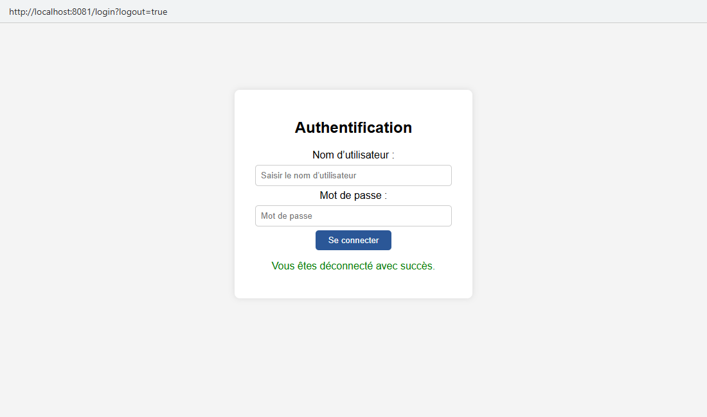

### 7.9 Connexion en tant que `admin`

Avec `admin` / `1234`, l'utilisateur arrive lui aussi sur `/home` :

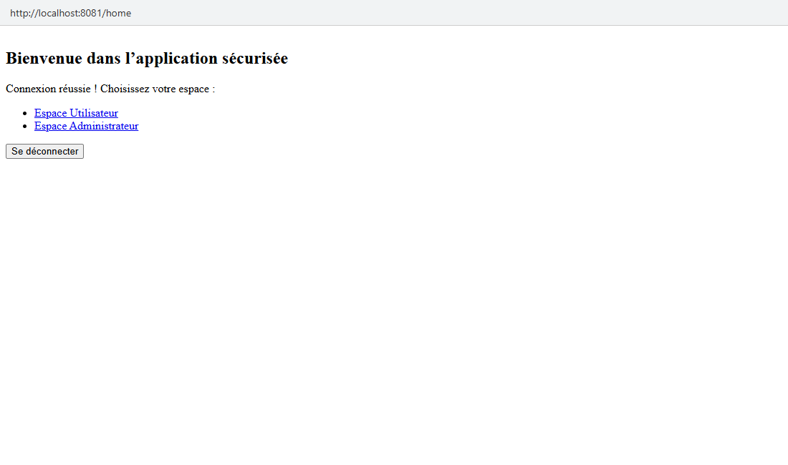

L'espace administrateur est accessible :

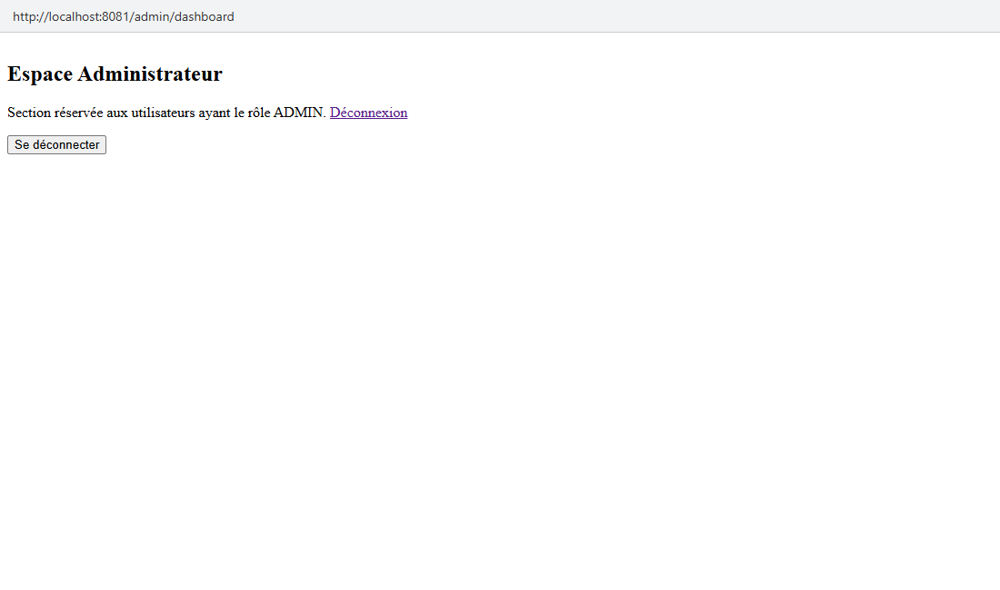

`admin` n'a que le rôle `ADMIN`, mais il peut aussi ouvrir l'espace utilisateur grâce à `hasAnyRole("USER", "ADMIN")` :

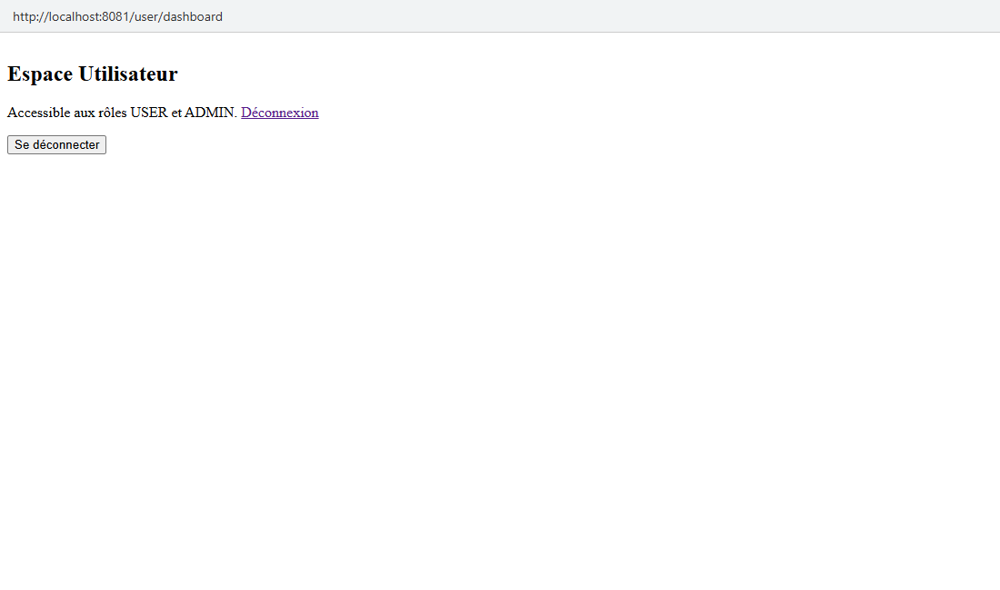

### 7.10 La racine `/` n'a pas de page

Une fois connecté, ouvrir `http://localhost:8080/` renvoie une erreur **404**, car aucune route n'est définie pour `/` (voir [remarque 8.2](#82-pas-de-page-pour-la-racine-)).


### 7.11 Test JUnit (`./mvnw test`)

Le projet contient le test généré par Spring Initializr, `contextLoads`. Il démarre tout le contexte Spring (`@SpringBootTest`) et vérifie qu'il se charge sans erreur, donc que `SecurityConfig` et `AuthController` sont valides.
Le test est dans le package `ma.fstg.security.tp10`, qui est sous `ma.fstg.security` : Spring trouve donc la classe `Tp10Application` en remontant les packages.

Résultat : **1 test, 0 échec**.

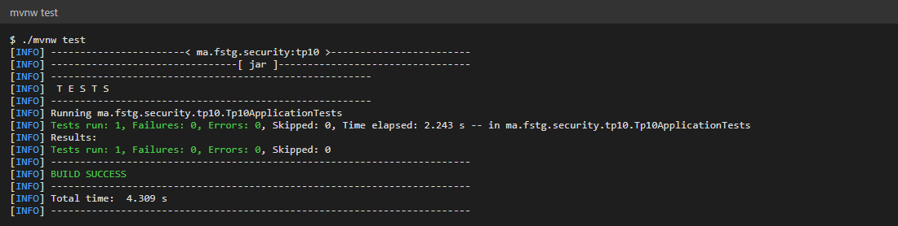

## 8. Remarques et limites

Ces points ont été observés pendant les essais. Ils n'empêchent pas l'application de fonctionner, mais sont à corriger dans une prochaine version.

### 8.1 Le lien « Déconnexion » renvoie une erreur 404

`user-dashboard.html` et `admin-dashboard.html` contiennent à la fois un **lien** et un **bouton** de déconnexion. Seul le bouton fonctionne.
Avec la protection CSRF activée (par défaut), Spring Security n'accepte la déconnexion qu'en **POST**. De plus, comme une page de login personnalisée est définie, Spring ne génère plus sa propre page de confirmation de déconnexion pour le GET.
**Correction possible :** supprimer le lien `<a th:href="@{/logout}">` et garder seulement le formulaire POST.

### 8.2 Pas de page pour la racine `/`

Aucune méthode du contrôleur ne gère `/`. Un utilisateur qui tape seulement `http://localhost:8080` est redirigé vers le login, puis tombe sur une erreur 404 une fois connecté.
**Correction possible :** ajouter une méthode `@GetMapping("/")` qui fait `return "redirect:/home";`.

### 8.3 Page 403 par défaut

L'accès refusé affiche la « Whitelabel Error Page » de Spring Boot.
**Correction possible :** créer un template `templates/error/403.html`. Spring Boot l'utilise automatiquement pour les erreurs 403.

### 8.4 Mots de passe en clair

Avec `{noop}`, les mots de passe sont stockés sans chiffrement. C'est pratique pour un TP, mais à éviter en production.
**Correction possible :** déclarer un bean `BCryptPasswordEncoder` et encoder les mots de passe avec `passwordEncoder.encode("1234")`, comme dans le TP9.

### 8.5 Trace de la pile affichée dans les pages d'erreur

Sur les pages 404, la trace complète de l'exception apparaît. C'est DevTools qui active cet affichage pendant le développement.
Ce n'est pas le cas quand l'application est lancée depuis le jar (`java -jar`), car DevTools est alors désactivé.

## 9. Conclusion

Ce TP m'a permis de voir que presque tout le comportement du login est paramétrable dans `formLogin()` et `logout()` :
le nom de l'URL de traitement, la page affichée après connexion, la redirection après un échec et après une déconnexion.
J'ai aussi bien compris la différence entre :
- **la redirection vers le login** : l'utilisateur n'est pas connecté ;
- **l'erreur 403** : l'utilisateur est connecté mais n'a pas le bon rôle ;
- **`hasRole`** (un seul rôle) et **`hasAnyRole`** (au moins un des rôles listés).

Enfin, les essais dans le navigateur ont montré qu'une déconnexion doit se faire en POST avec un jeton CSRF : un simple lien ne suffit pas.

Pistes d'amélioration :
- corriger les points de la [section 8](#8-remarques-et-limites) ;
- chiffrer les mots de passe avec BCrypt ;
- stocker les utilisateurs en base de données avec Spring Data JPA ;
- afficher le nom de l'utilisateur connecté et masquer le lien « Espace Administrateur » pour les non-admins avec `sec:authorize` ;
- ajouter des tests MockMvc pour vérifier automatiquement chaque règle d'accès.

---

**Auteur :** Mouad Handaji – Module JEE / Spring
