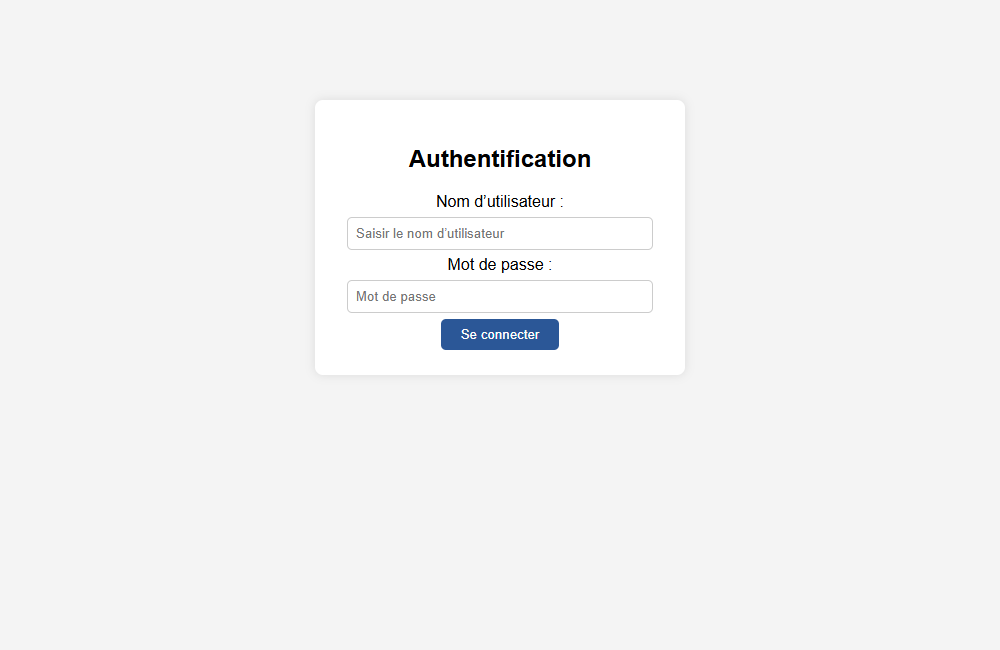
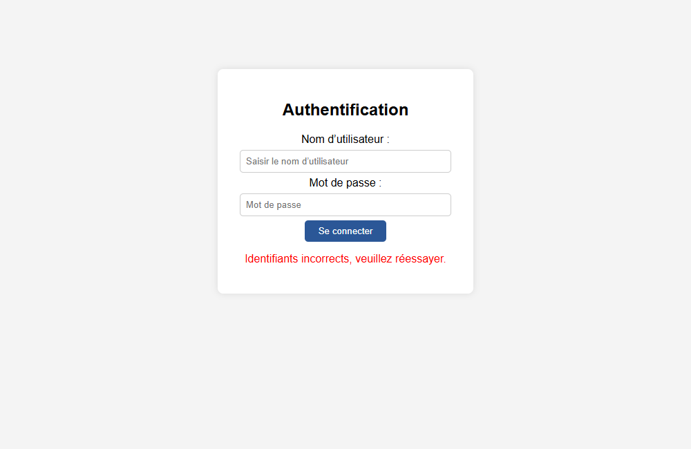
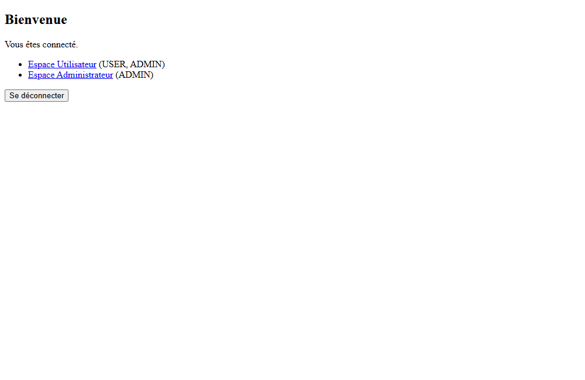
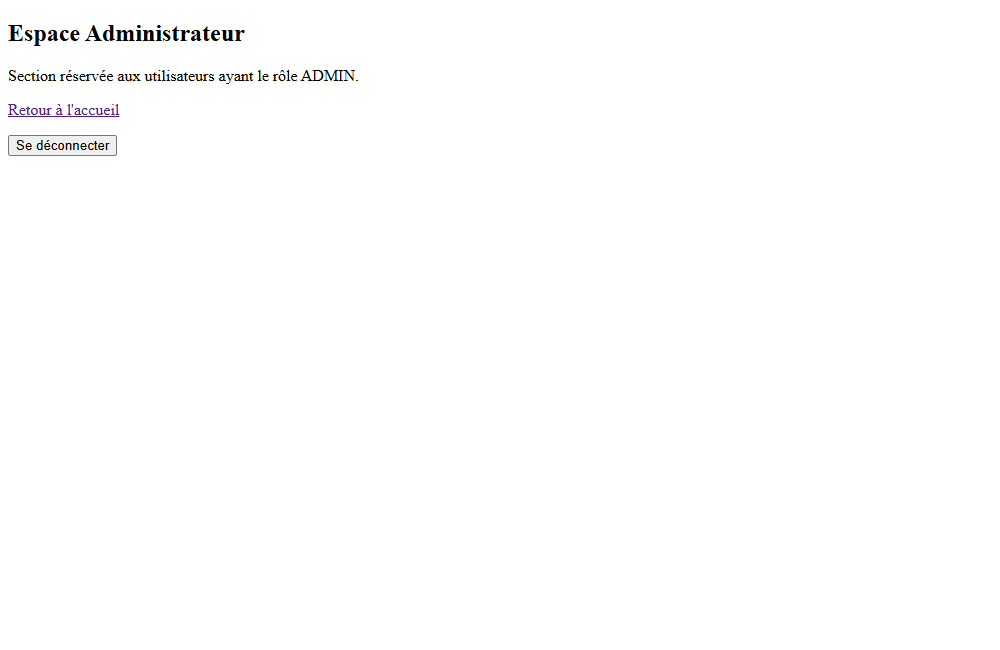
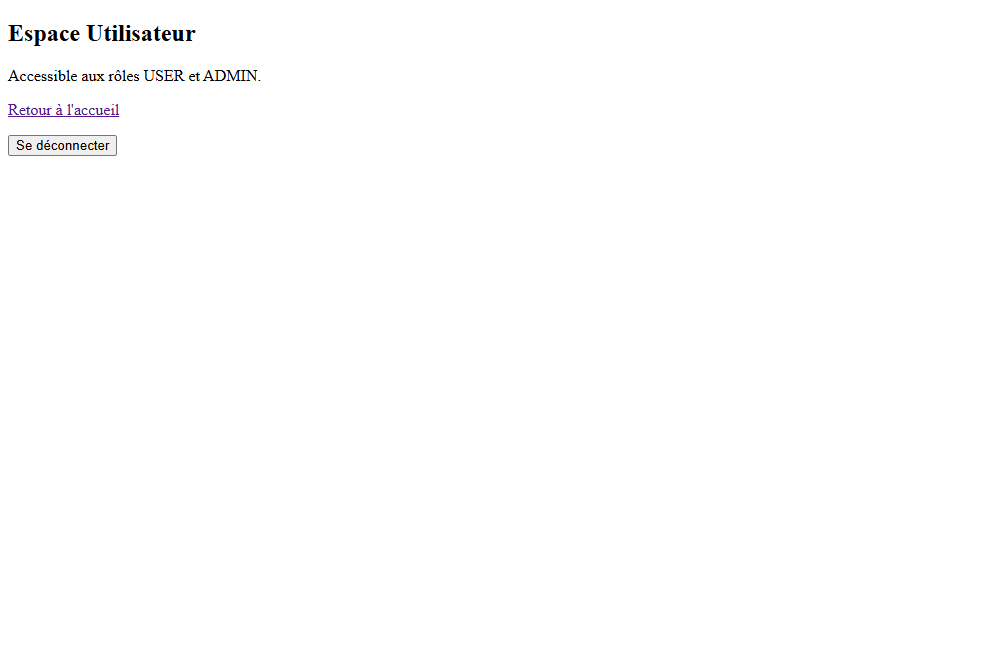
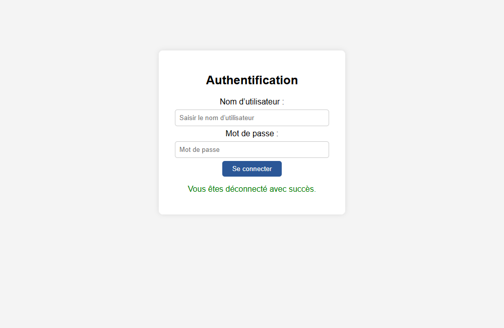
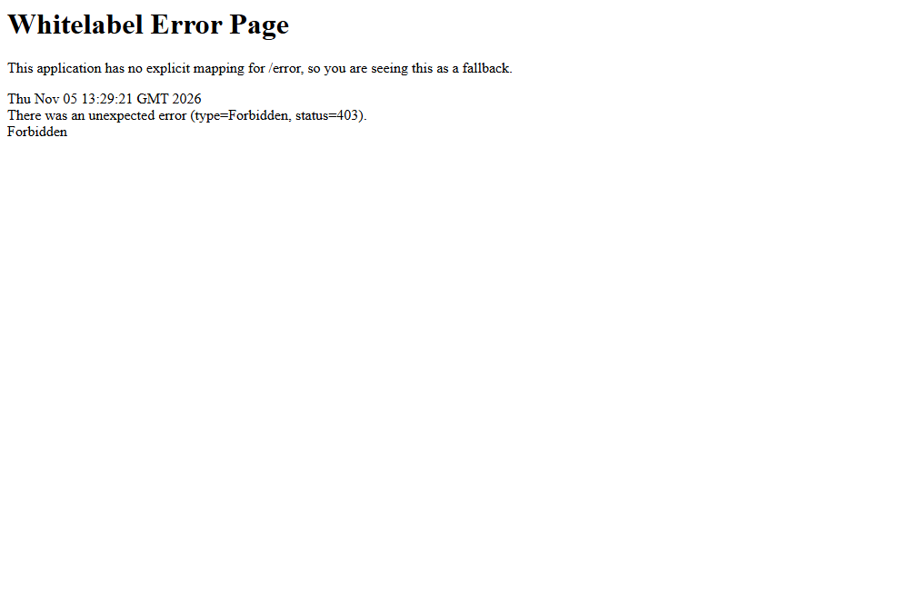

# TP11 – Spring Security avec JPA (MySQL)

Application Spring Boot qui sécurise des pages web avec **Spring Security**.
Les utilisateurs et leurs rôles sont stockés en base **MySQL** via **Spring Data JPA**, et les pages sont rendues avec **Thymeleaf**.

## Technologies

- Java 17, Spring Boot 4.1.2
- Spring Security (formulaire de connexion personnalisé, BCrypt)
- Spring Data JPA / Hibernate
- MySQL 8 (Docker)
- Thymeleaf, Lombok

## Structure du projet

```
src/main/java/ma/fstg/security
├── Tp11Application.java
├── config
│   ├── SecurityConfig.java         # règles d'accès, login, logout, BCrypt
│   └── DatabaseInitializer.java    # crée les rôles et utilisateurs de test au démarrage
├── controllers
│   └── AuthController.java         # /login, /home, /admin/dashboard, /user/dashboard
├── entities
│   ├── User.java                   # username, password, active, roles (ManyToMany)
│   └── Role.java                   # name (ROLE_ADMIN, ROLE_USER)
├── repositories
│   ├── UserRepository.java
│   └── RoleRepository.java
└── services
    └── CustomUserDetailsService.java  # charge l'utilisateur depuis la base pour Spring Security

src/main/resources/templates
├── login.html
├── home.html
├── admin-dashboard.html
└── user-dashboard.html
```

## Règles de sécurité

| URL | Accès |
|---|---|
| `/login`, `/register`, `/error` | public |
| `/admin/**` | rôle `ADMIN` |
| `/user/**` | rôles `USER` ou `ADMIN` |
| tout le reste (ex. `/home`) | utilisateur authentifié |

- Connexion : formulaire personnalisé sur `GET /login`, vérifié par Spring Security sur `POST /login`.
- Après connexion → `/home`. En cas d'échec → `/login?error=true`.
- Déconnexion : `POST /logout` (protégé par CSRF) → `/login?logout=true`.
- Mots de passe stockés hachés avec **BCrypt**.
- `hasRole("ADMIN")` vérifie l'autorité `ROLE_ADMIN` : les rôles sont donc enregistrés en base avec le préfixe `ROLE_`.

## Comptes de test

Créés automatiquement au démarrage par `DatabaseInitializer` (uniquement s'ils n'existent pas déjà) :

| Utilisateur | Mot de passe | Rôles |
|---|---|---|
| `admin` | `1234` | `ROLE_ADMIN`, `ROLE_USER` |
| `user` | `1111` | `ROLE_USER` |

## Lancer le projet

1. Démarrer MySQL :
   ```bash
   docker compose up -d
   ```
2. Lancer l'application :
   ```bash
   ./mvnw spring-boot:run
   ```
3. Ouvrir <http://localhost:8080>. Vous êtes redirigé vers la page de connexion.

## Captures d'écran

### 1. Page de connexion
Toute page protégée redirige vers `/login`.



### 2. Identifiants incorrects
`/login?error=true`



### 3. Accueil après connexion (admin)
`/home`



### 4. Espace administrateur (admin)
`/admin/dashboard` – accessible car `admin` possède `ROLE_ADMIN`.



### 5. Espace utilisateur (admin)
`/user/dashboard` – accessible aussi à l'admin.



### 6. Déconnexion
`/login?logout=true`



### 7. Espace utilisateur (user)
`/user/dashboard` avec le compte `user`.


### 8. Accès refusé (user → espace admin)
`/admin/dashboard` avec le compte `user` → **403 Forbidden**.


