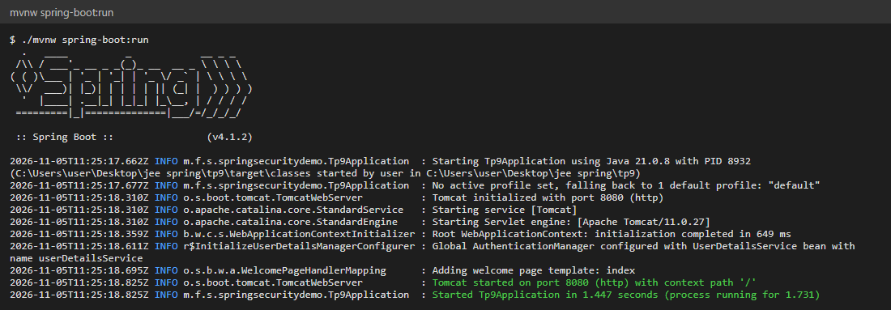
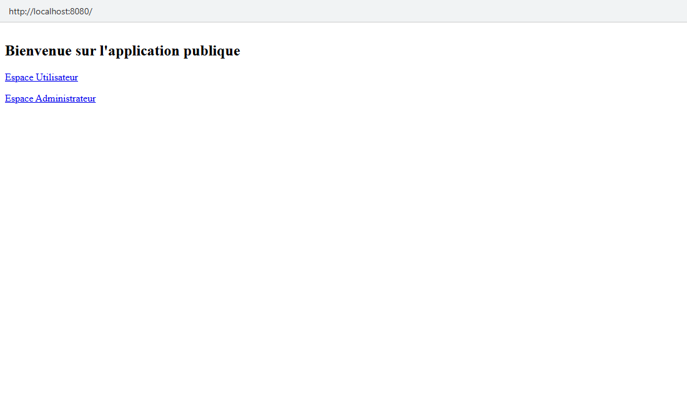
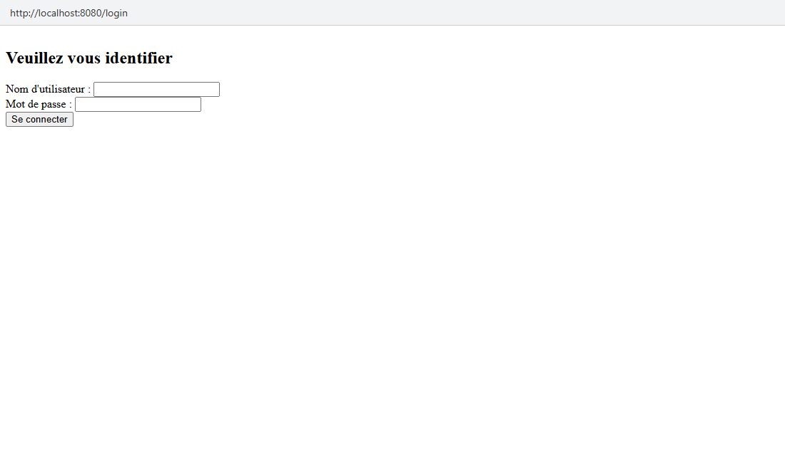
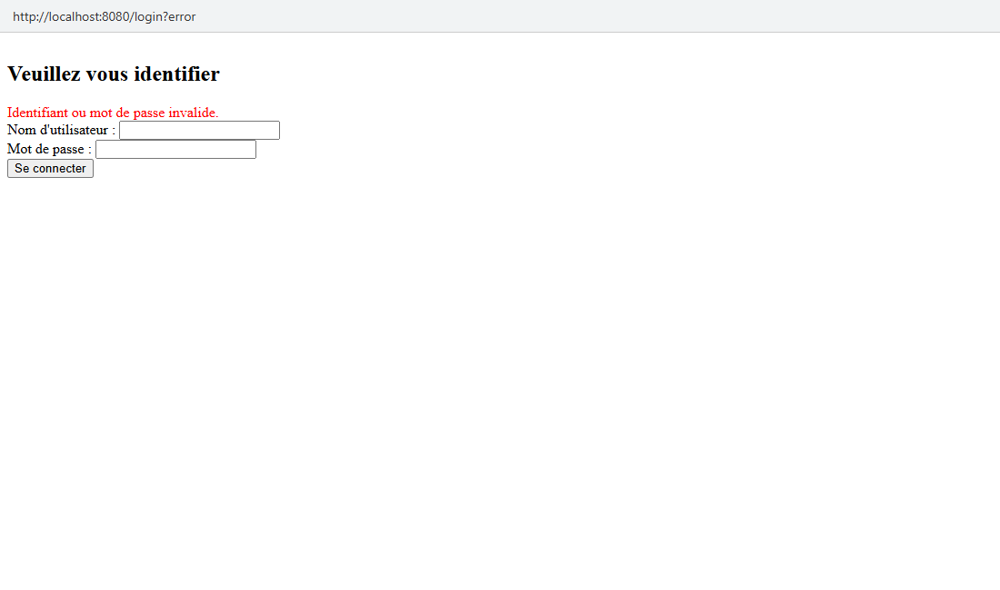
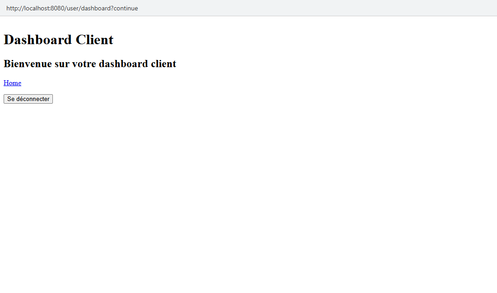
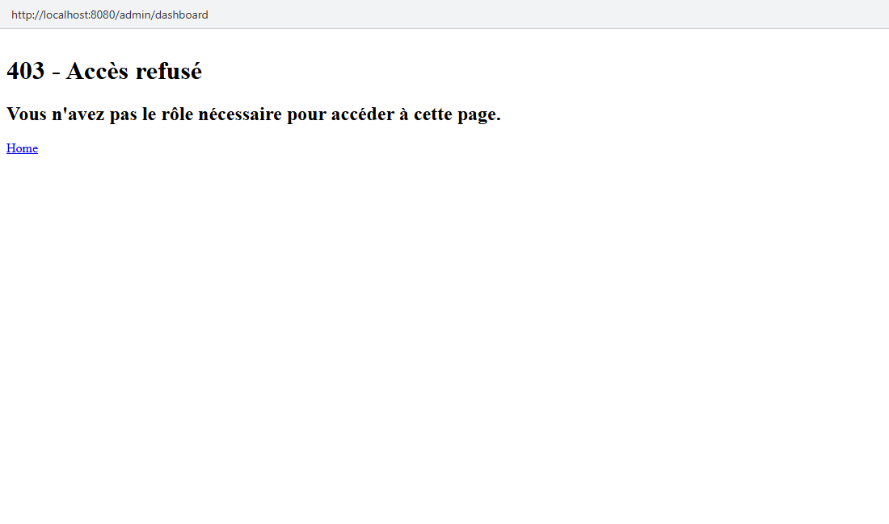
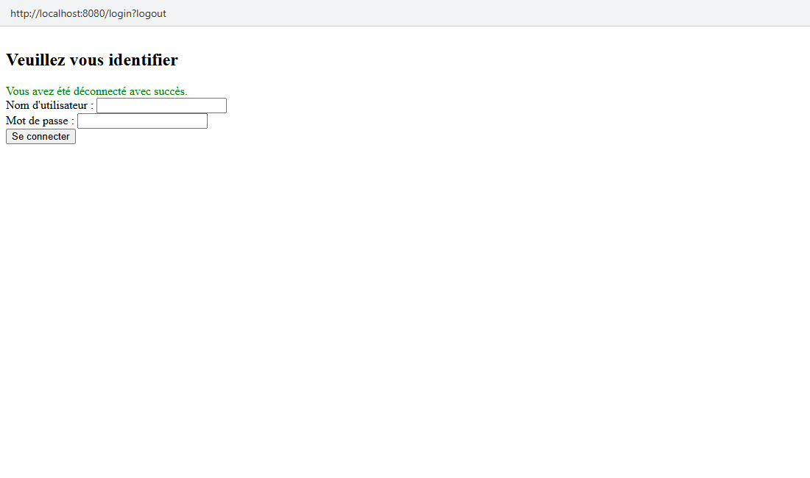
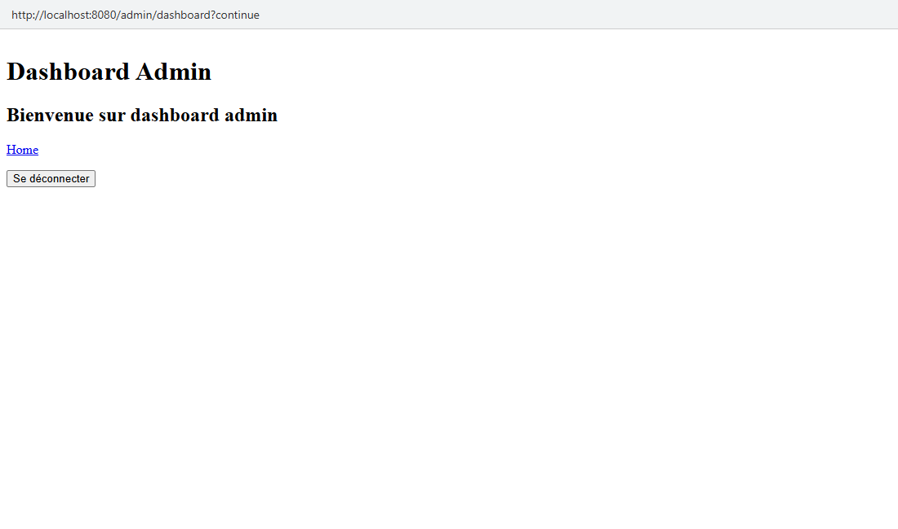
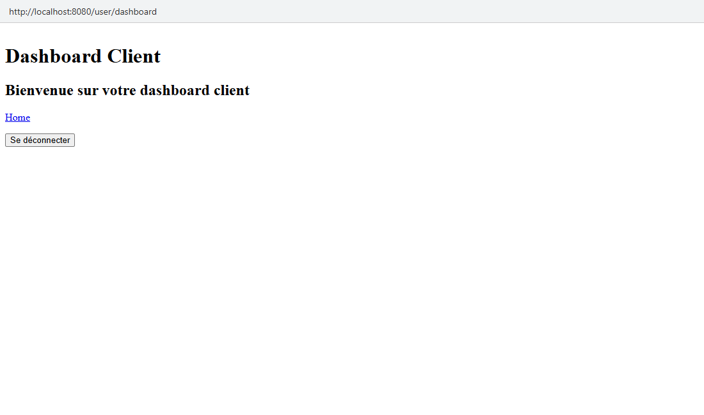
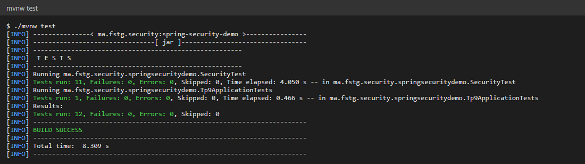

# TP9 – Sécurisation d'une application web avec Spring Security

Dans ce TP, j'ai sécurisé une petite application web **Spring Boot 4** (Spring MVC + Thymeleaf) avec **Spring Security**.
L'application contient une page d'accueil publique et deux espaces protégés : un **dashboard utilisateur** (rôle `USER`) et un **dashboard administrateur** (rôle `ADMIN`).
L'authentification se fait avec une **page de login personnalisée**, des utilisateurs en mémoire et des mots de passe chiffrés avec **BCrypt**.

---

## Sommaire

1. [Objectifs](#1-objectifs)
2. [Technologies utilisées](#2-technologies-utilisées)
3. [Structure du projet](#3-structure-du-projet)
4. [Explication du code](#4-explication-du-code)
5. [Routes et règles d'accès](#5-routes-et-règles-daccès)
6. [Lancer le projet](#6-lancer-le-projet)
7. [Tests et captures d'écran](#7-tests-et-captures-décran)
8. [Problèmes rencontrés](#8-problèmes-rencontrés)
9. [Conclusion](#9-conclusion)

---

## 1. Objectifs

- Configurer Spring Security avec un bean `SecurityFilterChain` (sans l'ancien `WebSecurityConfigurerAdapter`).
- Définir des règles d'accès par URL et par **rôle** (`hasRole("USER")`, `hasRole("ADMIN")`).
- Remplacer la page de login générée par Spring par une **page de login personnalisée** (Thymeleaf).
- Déclarer des utilisateurs en mémoire avec `InMemoryUserDetailsManager` et chiffrer leurs mots de passe avec `BCryptPasswordEncoder`.
- Gérer la déconnexion (logout en POST avec jeton CSRF) et l'accès refusé (page **403** personnalisée).
- Vérifier le comportement avec des tests **MockMvc** et dans le navigateur.

## 2. Technologies utilisées

| Outil | Version | Rôle |
|-------|---------|------|
| Java | 21 | Langage |
| Spring Boot | 4.1.2 | Framework principal |
| Spring MVC (`spring-boot-starter-webmvc`) | 7.x | Couche web (contrôleurs) |
| Spring Security (`spring-boot-starter-security`) | 7.x | Authentification et autorisation |
| Thymeleaf (`spring-boot-starter-thymeleaf`) | 3.1 | Moteur de templates HTML |
| `thymeleaf-extras-springsecurity6` | – | Intégration Thymeleaf / Spring Security |
| JUnit 5 + MockMvc + `spring-security-test` | – | Tests d'intégration |
| Maven Wrapper | – | Build |

## 3. Structure du projet

```
tp9
├── pom.xml
├── screenshots/                                   ← captures utilisées dans ce README
└── src
    ├── main
    │   ├── java/ma/fstg/security
    │   │   ├── springsecuritydemo/Tp9Application.java ← point d'entrée
    │   │   ├── config/SecurityConfig.java             ← règles de sécurité (SecurityFilterChain)
    │   │   ├── config/PasswordEncoderConfig.java      ← BCrypt + utilisateurs en mémoire
    │   │   ├── config/UserDetailsConfig.java          ← ancienne version, désactivée (voir 8.2)
    │   │   └── web/HomeController.java                ← routes / , /login, /user/**, /admin/**
    │   └── resources
    │       ├── application.properties
    │       └── templates
    │           ├── index.html                         ← accueil public
    │           ├── login.html                         ← page de login personnalisée
    │           ├── user_dashboard.html                ← espace USER
    │           ├── admin_dashboard.html               ← espace ADMIN
    │           └── error/403.html                     ← page « accès refusé »
    └── test/java/ma/fstg/security/springsecuritydemo
        ├── SecurityTest.java                          ← tests des règles de sécurité (MockMvc)
        └── Tp9ApplicationTests.java                   ← test de chargement du contexte
```

Chaque requête passe d'abord par la chaîne de filtres de Spring Security, avant d'arriver au contrôleur :

```
Navigateur
    │  HTTP
    ▼
SecurityFilterChain  ── non connecté ──────────► redirection vers /login
    │                ── connecté, mauvais rôle ─► 403 (error/403.html)
    │ autorisé
    ▼
HomeController  ──►  template Thymeleaf
```

## 4. Explication du code

### 4.1 Le point d'entrée et le scan des composants

```java
@SpringBootApplication(scanBasePackages = "ma.fstg.security")
public class Tp9Application {
    public static void main(String[] args) {
        SpringApplication.run(Tp9Application.class, args);
    }
}
```

`@SpringBootApplication` ne scanne par défaut que le package de la classe principale (`ma.fstg.security.springsecuritydemo`) et ses sous-packages.
Les packages `config` et `web` sont à côté, pas en dessous : sans `scanBasePackages`, la configuration de sécurité et le contrôleur sont ignorés (voir [problème 8.1](#81-routes-inaccessibles-et-page-de-login-personnalisée-ignorée)).

### 4.2 La configuration de sécurité

```java
@Configuration
@EnableWebSecurity
public class SecurityConfig {

    @Bean
    public SecurityFilterChain securityFilterChain(HttpSecurity http) throws Exception {
        http
                .authorizeHttpRequests(auth -> auth
                        .requestMatchers("/", "/css/**", "/error").permitAll()
                        .requestMatchers("/user/**").hasRole("USER")
                        .requestMatchers("/admin/**").hasRole("ADMIN")
                        .anyRequest().authenticated()
                )
                .formLogin(form -> form
                        .loginPage("/login")
                        .permitAll()
                )
                .logout(logout -> logout
                        .logoutSuccessUrl("/login?logout")
                        .permitAll()
                );
        return http.build();
    }
}
```

- Les règles sont lues **dans l'ordre** : la première qui correspond à l'URL s'applique.
- `/`, les fichiers CSS et `/error` sont publics. Sans `/error`, une erreur redirigerait vers le login au lieu d'afficher la page d'erreur.
- `hasRole("USER")` vérifie l'autorité `ROLE_USER` : Spring ajoute le préfixe `ROLE_` tout seul.
- `.loginPage("/login")` remplace la page de login générée par Spring. Spring Security continue de traiter le **POST** `/login` (vérification des identifiants), mais c'est à nous de servir le **GET** `/login`.
- Après déconnexion, l'utilisateur est renvoyé vers `/login?logout`, ce qui affiche le message de confirmation de la page de login.

### 4.3 Les utilisateurs et le chiffrement des mots de passe

```java
@Configuration
public class PasswordEncoderConfig {

    @Bean
    public PasswordEncoder passwordEncoder() {
        return new BCryptPasswordEncoder();
    }

    @Bean
    public UserDetailsService userDetailsService(PasswordEncoder passwordEncoder) {
        UserDetails user = User.withUsername("user")
                .password(passwordEncoder.encode("1111"))
                .roles("USER")
                .build();

        UserDetails admin = User.withUsername("admin")
                .password(passwordEncoder.encode("1234"))
                .roles("ADMIN", "USER")
                .build();

        return new InMemoryUserDetailsManager(user, admin);
    }
}
```

| Utilisateur | Mot de passe | Rôles | Accès |
|-------------|--------------|-------|-------|
| `user` | `1111` | `USER` | `/user/**` |
| `admin` | `1234` | `ADMIN`, `USER` | `/user/**` et `/admin/**` |

Les mots de passe ne sont jamais stockés en clair : `BCryptPasswordEncoder` produit un hash salé (`$2a$10$...`).
À la connexion, Spring hashe le mot de passe saisi et le compare au hash enregistré.

### 4.4 Le contrôleur

```java
@Controller
public class HomeController {

    @GetMapping("/")
    public String index() { return "index"; }

    @GetMapping("/login")
    public String login() { return "login"; }

    @GetMapping("/user/dashboard")
    public String userDashboard() { return "user_dashboard"; }

    @GetMapping("/admin/dashboard")
    public String adminDashboard() { return "admin_dashboard"; }
}
```

Chaque méthode renvoie le nom d'un template Thymeleaf situé dans `src/main/resources/templates`.
Le contrôleur ne contient aucune logique de sécurité : tout est centralisé dans `SecurityConfig`.

### 4.5 La page de login personnalisée

```html
<div th:if="${param.error}" style="color: red;">
    Identifiant ou mot de passe invalide.
</div>
<div th:if="${param.logout}" style="color: green;">
    Vous avez été déconnecté avec succès.
</div>
<form th:action="@{/login}" method="post">
    <input type="text" name="username" required />
    <input type="password" name="password" required />
    <button type="submit">Se connecter</button>
</form>
```

- Les champs doivent s'appeler `username` et `password` : ce sont les noms attendus par défaut par Spring Security.
- `th:action="@{/login}"` ajoute **automatiquement** un champ caché contenant le jeton **CSRF**. Sans lui, le POST serait refusé (403).
- `${param.error}` et `${param.logout}` lisent les paramètres d'URL ajoutés par Spring après un échec de connexion ou une déconnexion.

### 4.6 La déconnexion et la page 403

Les deux dashboards contiennent un bouton de déconnexion. La déconnexion se fait en **POST** (protection CSRF), pas avec un simple lien :

```html
<form th:action="@{/logout}" method="post">
    <button type="submit">Se déconnecter</button>
</form>
```

Quand un utilisateur connecté n'a pas le bon rôle, Spring renvoie une erreur 403.
Spring Boot affiche alors automatiquement le template `templates/error/403.html` s'il existe, au lieu de la « Whitelabel Error Page ».

## 5. Routes et règles d'accès

URL de base : `http://localhost:8080`

| Route | Anonyme | `user` (USER) | `admin` (ADMIN, USER) |
|-------|---------|---------------|-----------------------|
| `GET /` | ✅ | ✅ | ✅ |
| `GET /login` | ✅ | ✅ | ✅ |
| `GET /user/dashboard` | ↪ `/login` | ✅ | ✅ |
| `GET /admin/dashboard` | ↪ `/login` | ⛔ 403 | ✅ |
| `POST /logout` | – | ↪ `/login?logout` | ↪ `/login?logout` |

## 6. Lancer le projet

**Prérequis :** JDK 21 ou plus récent. Maven n'est pas nécessaire, car le wrapper `mvnw` est fourni.

```bash
# Lancer l'application
./mvnw spring-boot:run          # Linux / macOS / Git Bash
mvnw.cmd spring-boot:run        # Windows (cmd)

# ou construire le jar puis l'exécuter
./mvnw clean package
java -jar target/spring-security-demo-0.0.1-SNAPSHOT.jar
```

Ouvrir ensuite http://localhost:8080 et se connecter avec `user` / `1111` ou `admin` / `1234`.

Pour lancer les tests :

```bash
./mvnw test
```

Astuce pendant le développement : ajouter `spring.thymeleaf.cache=false` dans `application.properties` pour voir les modifications des templates sans redémarrer l'application.

## 7. Tests et captures d'écran

### 7.1 Démarrage de l'application

Tomcat démarre sur le port 8080. La ligne `Global AuthenticationManager configured with UserDetailsService bean with name userDetailsService` confirme que Spring utilise bien nos utilisateurs en mémoire, et non l'utilisateur généré par défaut (avec un mot de passe aléatoire affiché dans la console).



### 7.2 Page d'accueil publique

La page `/` est accessible sans être connecté. Elle propose des liens vers les deux espaces protégés.



### 7.3 Redirection vers la page de login personnalisée

En cliquant sur « Espace Utilisateur » sans être connecté, Spring Security mémorise la page demandée puis redirige vers **notre** page `/login` (et non la page générée par défaut).



### 7.4 Mauvais mot de passe

Avec un mot de passe incorrect, Spring redirige vers `/login?error` et le message rouge s'affiche.



### 7.5 Connexion en tant que `user`

Après une connexion réussie avec `user` / `1111`, Spring renvoie vers la page demandée au départ.
Le paramètre `?continue` est ajouté par Spring Security : il indique que la requête mémorisée avant le login a été reprise.



### 7.6 `user` essaie d'ouvrir le dashboard admin → 403

`user` est bien connecté mais n'a pas le rôle `ADMIN`. Il n'est pas redirigé vers le login : il reçoit une erreur **403**, affichée avec le template `error/403.html`.



### 7.7 Déconnexion

Le bouton « Se déconnecter » envoie un POST sur `/logout`. La session est invalidée et l'utilisateur arrive sur `/login?logout` avec le message vert.



Après la déconnexion, revenir sur `/user/dashboard` redirige de nouveau vers le login : la session est bien terminée.


### 7.8 Connexion en tant que `admin`

Avec `admin` / `1234`, le dashboard administrateur est accessible :



Comme `admin` possède aussi le rôle `USER`, il peut également ouvrir le dashboard utilisateur :



### 7.9 Tests JUnit (`./mvnw test`)

La classe `SecurityTest` charge toute l'application (`@SpringBootTest`) et envoie des requêtes avec **MockMvc** (`@AutoConfigureMockMvc`).
`@WithMockUser` simule un utilisateur connecté avec un rôle donné. `formLogin()` et `logout()` (de `spring-security-test`) simulent un vrai login et un vrai logout, avec le jeton CSRF.

| Test | Ce qui est vérifié |
|------|--------------------|
| `accueilPublic` | `GET /` sans connexion → 200, vue `index` |
| `pageLoginPersonnalisee` | `GET /login` → 200, vue `login` (notre template) |
| `dashboardUserSansConnexionRedirigeVersLogin` | `GET /user/dashboard` anonyme → redirection `/login` |
| `dashboardAdminSansConnexionRedirigeVersLogin` | `GET /admin/dashboard` anonyme → redirection `/login` |
| `userAccedeAuDashboardUser` | rôle USER sur `/user/dashboard` → 200 |
| `userInterditSurDashboardAdmin` | rôle USER sur `/admin/dashboard` → 403 |
| `adminAccedeAuDashboardAdmin` | rôles ADMIN + USER sur `/admin/dashboard` → 200 |
| `loginUserValide` | login `user` / `1111` → authentifié avec le rôle USER |
| `loginAdminValide` | login `admin` / `1234` → authentifié avec les rôles ADMIN et USER |
| `loginMauvaisMotDePasse` | mauvais mot de passe → non authentifié, redirection `/login?error` |
| `logoutRedirigeVersLogin` | logout → non authentifié, redirection `/login?logout` |

Résultat : **12 tests, 0 échec** (le douzième est `contextLoads`).



## 8. Problèmes rencontrés

### 8.1 Routes inaccessibles et page de login personnalisée ignorée

Au début, aucune route ne fonctionnait et Spring affichait sa propre page de login au lieu de la mienne. Un mot de passe aléatoire apparaissait aussi dans la console.
La cause : la classe principale est dans `ma.fstg.security.springsecuritydemo`, alors que `SecurityConfig` et `HomeController` sont dans `ma.fstg.security.config` et `ma.fstg.security.web`.
Ces packages ne sont pas **sous** celui de la classe principale, donc le scan des composants ne les trouvait pas. Spring Boot appliquait alors sa sécurité par défaut (tout protégé, page de login générée, utilisateur `user` avec un mot de passe aléatoire), et aucun contrôleur n'existait.
**Solution :** `@SpringBootApplication(scanBasePackages = "ma.fstg.security")`. Une autre solution aurait été de déplacer `Tp9Application` dans `ma.fstg.security`.

### 8.2 Deux beans `userDetailsService`

`UserDetailsConfig` (mots de passe `{noop}`) et `PasswordEncoderConfig` (mots de passe BCrypt) déclaraient tous les deux un bean nommé `userDetailsService`.
Une fois le scan corrigé, le démarrage échouait, car Spring Boot refuse par défaut de remplacer un bean par un autre du même nom.
De plus, les mots de passe `{noop}` ne fonctionnent pas avec un bean `BCryptPasswordEncoder` : ce préfixe n'est compris que par le `DelegatingPasswordEncoder` utilisé par défaut.
**Solution :** garder la version BCrypt et désactiver `UserDetailsConfig` (son `@Configuration` est commenté).

### 8.3 Pas de route pour `GET /login`

`.loginPage("/login")` indique seulement à Spring Security **où rediriger** l'utilisateur. Il ne crée pas la page.
Sans contrôleur pour `GET /login`, la redirection aboutissait à une erreur 404.
**Solution :** ajouter `@GetMapping("/login")` qui renvoie le template `login`.

### 8.4 Mauvaise syntaxe des liens Thymeleaf

Les templates utilisaient `th:href="@('/user/dashboard')"`, une syntaxe invalide qui provoque une erreur au rendu de la page.
**Solution :** la bonne syntaxe des URL Thymeleaf est `@{...}`, par exemple `th:href="@{/user/dashboard}"` et `th:action="@{/login}"`.

### 8.5 Pas de page de logout

Quand on définit une page de login personnalisée, Spring Security ne génère plus non plus sa page de confirmation de logout : `GET /logout` renvoyait donc une erreur 404, et l'application n'avait aucun bouton de déconnexion.
**Solution :** ajouter un formulaire `POST /logout` dans les dashboards (le jeton CSRF est ajouté par `th:action`) et rediriger vers `/login?logout` pour afficher le message de confirmation déjà prévu dans `login.html`.

### 8.6 Page 403 peu lisible

Un utilisateur sans le bon rôle voyait la « Whitelabel Error Page » de Spring Boot.
**Solution :** créer `templates/error/403.html`. Spring Boot l'utilise automatiquement pour toutes les erreurs 403.

## 9. Conclusion

Ce TP m'a montré qu'avec Spring Security, toute la sécurité d'une application web peut être centralisée dans un seul bean `SecurityFilterChain` :
les contrôleurs restent simples et ne contiennent aucune vérification de rôle.
J'ai aussi compris la différence entre **401/redirection vers le login** (utilisateur non connecté) et **403** (utilisateur connecté mais sans le bon rôle),
ainsi que le rôle du jeton CSRF, ajouté automatiquement par Thymeleaf dans les formulaires.
Le problème le plus instructif a été le scan des composants : une simple différence de package suffisait pour que Spring ignore toute ma configuration sans afficher d'erreur.

Pistes d'amélioration :
- stocker les utilisateurs en base de données (Spring Data JPA + un `UserDetailsService` personnalisé) ;
- afficher le nom de l'utilisateur connecté et masquer les liens selon le rôle avec `sec:authorize` (Thymeleaf extras) ;
- ajouter une option « Se souvenir de moi » (`rememberMe()`) ;
- ajouter une feuille de style `css/style.css` pour la page de login.

---

**Auteur :** Mouad Handaji – Module JEE / Spring
